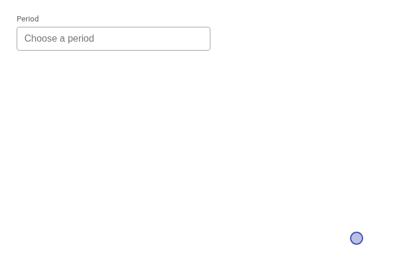

# ngx-daterangepicker-material

> Date range picker for Angular, with predefined ranges and a time picker.

[](https://github.com/fetrarij/ngx-daterangepicker-material/actions)
[](https://badge.fury.io/js/ngx-daterangepicker-material)
[](https://www.npmjs.com/package/ngx-daterangepicker-material)
[](https://github.com/fetrarij/ngx-daterangepicker-material/blob/master/LICENSE)
[](https://github.com/fetrarij/ngx-daterangepicker-material/commits/master)

A date range picker with a Material look. It works with Angular 22, standalone components, SSR and zoneless apps. It uses `dayjs` to handle dates. It started as a port of the [Bootstrap Date Range Picker](http://www.daterangepicker.com), without its jQuery, Bootstrap and moment.js dependencies.

Actively maintained again since 2026. New issues get a reply.



Demo: https://fetrarij.github.io/ngx-daterangepicker-material/, with live examples and their code. In the [playground](https://fetrarij.github.io/ngx-daterangepicker-material/full), pick the options and copy the code it writes for you.

Try it online: [open the example on StackBlitz](https://stackblitz.com/github/fetrarij/ngx-daterangepicker-material/tree/master/examples/stackblitz)

## Why this library

Compared to the Angular Material date range picker, it gives you:

- predefined ranges (Today, Last 7 days, This month...), or your own;
- an optional time picker;
- one input where users can type or pick the whole range.

## Contents

- [Versions](#versions)
- [Installation](#installation)
- [Usage example](#usage-example)
- [Inline usage](#inline-usage)
- [Signal Forms](#signal-forms)
- [Available options](#available-options)
- [Available events](#available-events)
- [Contributing](#contributing)

---

## Versions

| Angular| ngx-daterangepicker-material|
| ------|:------:|
| 22.x.x  | v22.x.x |
| 21.x.x  | v21.x.x |
| 20.x.x  | v20.x.x |
| 19.x.x  | v19.x.x |
| 17.x.x  | v17.x.x |
| 16.x.x  | v16.x.x |
| 12.0.0 - 15.x.x  | v6.x.x |
| <=11.0.0  | v5.x.x |
| >=9.0.0  | v4.x.x |
| <9.0.0  | v2.x.x |
| ~~>=9.0.0 depends on @angular/material~~ |~~v3.x~~ |

Since v16, the package's major version tracks the Angular major version it supports

### Upgrade from 6.x

`"^6.0.4"` in your `package.json` never moves to a newer major. To get the new versions, install the one that matches your Angular major (see the table above), for example:

```bash
npm install ngx-daterangepicker-material@22   # Angular 22
```

The bug fixes made since 2026 are in v22 only. v16 to v21 mainly add support for their Angular version.

The setup and the API stay the same: `NgxDaterangepickerMd.forRoot()`, the same inputs and outputs. In a standalone app, see [Standalone apps](#standalone-apps).

What you may notice when you move from 6.x to 22.x (details in the [release notes](https://github.com/fetrarij/ngx-daterangepicker-material/releases)):

- The emitted dates are the real local dates. If you fixed a timezone shift yourself (for example with `toISOString().substring(...)` or by adding the UTC offset), remove that code.
- `isInvalidDate` and `isCustomDate` also get local dates. Compare by day: `date.isSame(other, 'day')`.
- Without time picker, the end date is the end of the day (`23:59:59.999`).
- A value like `{ startDate: null, endDate: null }` leaves the input empty instead of showing today. For a required field, use [`dateRangeRequired()`](#required-validation) instead of `Validators.required`.
- Closing the picker without Apply drops the unapplied selection.
- A dayjs `locale` given to `forRoot()` also sets the day and month names.
- dayjs 1.11.10 or newer is needed.

---

## Installation

### With ng add

```bash
ng add ngx-daterangepicker-material
```

It installs the package and registers `NgxDaterangepickerMd.forRoot()` for you: in
`app.config.ts` for a standalone app, or in your root `NgModule`. Available since v22.1.3.

Then import `NgxDaterangepickerMd` and `FormsModule` in the component that uses the picker
(see the component example below).

### Manual setup

Install the package from npm:

```bash
npm install ngx-daterangepicker-material
```

#### Standalone apps

`NgxDaterangepickerMd` is still an `NgModule` internally, but it works with standalone
applications too. Register `NgxDaterangepickerMd.forRoot()`'s providers once with
`importProvidersFrom` in your app config:

````typescript
// app.config.ts
import { ApplicationConfig, importProvidersFrom } from '@angular/core';
import { NgxDaterangepickerMd } from 'ngx-daterangepicker-material';

export const appConfig: ApplicationConfig = {
  providers: [
    importProvidersFrom(NgxDaterangepickerMd.forRoot())
  ]
};
````

Then import `NgxDaterangepickerMd` directly in any standalone component that uses the
directive:

````typescript
// app.ts
import { Component } from '@angular/core';
import { FormsModule } from '@angular/forms';
import { NgxDaterangepickerMd } from 'ngx-daterangepicker-material';

@Component({
  selector: 'app-root',
  imports: [FormsModule, NgxDaterangepickerMd],
  templateUrl: './app.html'
})
export class App {
  selected: { startDate: unknown; endDate: unknown } | null = null;
}
````

`forRoot()` must only be called once, from `app.config.ts` — do not add it again to a
component's own `imports` array.

#### NgModule apps

Import **NgxDaterangepickerMd** in your module:

````typescript
...
import { FormsModule } from '@angular/forms';
import { NgxDaterangepickerMd } from 'ngx-daterangepicker-material';
import { App } from './app';

@NgModule({
    imports: [
        ... ,
        FormsModule,
        NgxDaterangepickerMd.forRoot()
    ],
    declarations: [App],
    bootstrap:    [App]
})
export class AppModule {}
````

### Older apps: TS1259 error

`dayjs` needs `esModuleInterop` (or `allowSyntheticDefaultImports`). Apps created with
Angular CLI 20 or later already have it (through `"module": "preserve"`), so there is nothing
to do. In an older app, if the build fails with `TS1259`, add this to your `tsconfig.json`:

```json
{
  "compilerOptions": {
    "esModuleInterop": true
  }
}
```

### Testing with Jest

The library imports `dayjs/esm`, which Jest can't load as is (`SyntaxError: Cannot use import statement outside a module`). Point Jest to the CommonJS build of dayjs in your `jest.config.js`:

```js
moduleNameMapper: {
  '^dayjs/esm$': 'dayjs',
  '^dayjs/esm/(.*)$': 'dayjs/$1'
}
```

Keep `esModuleInterop: true` in the tsconfig used by your tests. Alternatively, let Jest transform dayjs: `transformIgnorePatterns: ['node_modules/(?!(dayjs|.*\\.mjs$))']`.

## Usage example

Html:

```html
<input type="text" ngxDaterangepickerMd [(ngModel)]="selected" class="form-control"/>
```
Typescript:

````typescript
selected: {startDate: Dayjs, endDate: Dayjs};
````

The user can also type the dates in the input and press Enter to apply them. Closing the picker without Apply (click outside, Escape or Cancel) keeps the last applied value.

With `singleDatePicker`, the value can also be a single date (dayjs date, native `Date` or ISO string). The picker still sends `{startDate, endDate}` back.
### with some options:
Html:

```html
<input type="text" matInput
    ngxDaterangepickerMd
    [locale]="{applyLabel: 'ok', format: 'DD-MM-YYYY'}"
    startKey="start"
    endKey="end"
    [(ngModel)]="selected"
    name="daterange"/>
```
Typescript:

````typescript
selected: {start: Dayjs, end: Dayjs};
````
You can [play with our online demo here](https://fetrarij.github.io/ngx-daterangepicker-material/), try the options in the [playground](https://fetrarij.github.io/ngx-daterangepicker-material/full),
and [browse our demo code here](./demo/src/app).

## Inline usage

You can use the component directly in your templates, which will set its `inline` mode to **true**, in which case the calendar won't hide after date/range selection. You can then use the events: `rangeClicked` or `datesUpdated` or `choosedDate` to get its selection state.

```html
<ngx-daterangepicker-material (choosedDate)="choosedDate($event)">
</ngx-daterangepicker-material>
```

Since 22.2.0, the inline component also works with `ngModel` and `formControl`:

```html
<ngx-daterangepicker-material [(ngModel)]="selected"></ngx-daterangepicker-material>
<ngx-daterangepicker-material [formControl]="range"></ngx-daterangepicker-material>
```

The value is `{ startDate: Dayjs, endDate: Dayjs }`. It changes on Apply (or on each selection with `autoApply`) and on Clear, not on each day click. In single mode you can also give a plain date. `control.disable()` greys out the calendar and blocks clicks. `startKey` and `endKey` only work on the input.

## Signal Forms

Since 22.2.1, the input and the inline component work with Angular Signal Forms (`@angular/forms/signals`) through `[formField]`:

```typescript
import { FormField, disabled, form } from '@angular/forms/signals';

@Component({
  imports: [NgxDaterangepickerMd, FormField],
  template: `
    <input ngxDaterangepickerMd [formField]="bookingForm.dates" />
    <ngx-daterangepicker-material [formField]="bookingForm.dates"></ngx-daterangepicker-material>
  `
})
export class BookingComponent {
  locked = signal(false);
  booking = signal<{ dates: TimePeriod }>({ dates: { startDate: dayjs(), endDate: dayjs().add(3, 'day') } });
  bookingForm = form(this.booking, (path) => disabled(path.dates, () => this.locked()));
}
```

The value has the same shape as with `ngModel`, and the `disabled()` rule disables the picker. [See it in the demo](https://fetrarij.github.io/ngx-daterangepicker-material/reactive-forms#signal-form).


## Available options

### autoApply, showDropdowns, singleDatePicker, showWeekNumbers, showISOWeekNumbers, alwaysShowCalendars, showClearButton, showCancel

>These options are booleans

### isCustomDate

>(function) A function that is passed each date in the calendars before they are displayed, and may return a string or array of CSS class names to apply to that date's calendar cell

### isInvalidDate
>(function) A function that is passed each date in the two calendars before they are displayed, and may return true or false to indicate whether that date should be available for selection or not.

Both functions get a local dayjs date. The time of that date is not always midnight, so compare by day: `date.isSame(other, 'day')`.

### isTooltipDate
>(function) A function that is passed each date in the two calendars before they are displayed, and may return a text to be displayed as a tooltip.

### minDate, maxDate

 >To set the minimal and maximal date, these options are a dayjs date, a native `Date`, or a string in [ISO](https://www.w3.org/QA/Tips/iso-date) format

Dayjs dates can come from `import dayjs from 'dayjs'` or from `'dayjs/esm'`, both work (this also applies to `ranges`, `startDate` and `endDate`). An unknown value is ignored, with a warning in the console in dev mode.

With `showDropdowns`, the year list goes from the year of `minDate` to the year of `maxDate`. Without them, it goes from 50 years ago to 5 years ahead.

### dateLimit

 >To set max number of the date we can choose

### initialDates

 >To set the months shown in the left and right calendars when the picker opens with no selected date. It's an array of two dates (dayjs dates or strings in [ISO](https://www.w3.org/QA/Tips/iso-date) format), it doesn't select any date.

For example, to open on the previous and current month instead of the current and next month:
```html
<input type="text" ngxDaterangepickerMd [initialDates]="[previousMonth, currentMonth]" [(ngModel)]="selected" />
```
```typescript
previousMonth = dayjs().subtract(1, 'month');
currentMonth = dayjs();
```

### allowEmptyEndDate

 >Set to `true` to let the user apply a start date alone, for an open range like "from October 1". Default is `false`, where Apply with only a start date ends the range on the same day.

The value then has an empty end date: `{ startDate: dayjs, endDate: null }`. The input shows the start date and the separator, like `10/01/2026 - `. To show another text, set `emptyEndDateLabel` in the [locale](#locale), where `{start}` is replaced by the start date:

```html
<input ngxDaterangepickerMd [allowEmptyEndDate]="true" [locale]="{ emptyEndDateLabel: 'From {start}' }" [(ngModel)]="selected" />
```

A value with `endDate: null` from ngModel or a form control is shown the same way. When the picker opens again, the first click starts a new selection. [See it in the demo](https://fetrarij.github.io/ngx-daterangepicker-material/custom-ranges#open-end-date).

### locale

>the locale options is an object with:
```javascript
{
    format: 'MM/DD/YYYY', // could be 'YYYY-MM-DDTHH:mm:ss.SSSSZ'
    displayFormat: 'MM/DD/YYYY', // default is format value
    direction: 'ltr', // could be rtl
    weekLabel: 'W',
    separator: ' To ', // default is ' - '
    cancelLabel: 'Cancel', // detault is 'Cancel'
    applyLabel: 'Okay', // detault is 'Apply'
    clearLabel: 'Clear', // detault is 'Clear'
    customRangeLabel: 'Custom range',
    emptyEndDateLabel: 'From {start}', // only with allowEmptyEndDate, default is the start date and the separator
    daysOfWeek: dayjs.weekdaysMin(),
    monthNames: dayjs.monthsShort(),
    firstDay: 1 // first day is monday
}
```

To use a language, pass a dayjs locale as `locale`. It gives the day and month names, the first day of the week, and the language of the dates shown in the input:

```typescript
import fr from 'dayjs/esm/locale/fr';

frLocale = { locale: fr, format: 'D MMMM YYYY', applyLabel: 'Appliquer' };
```

```html
<input ngxDaterangepickerMd [locale]="frLocale" [(ngModel)]="selected" />
```

The `[locale]` input can be changed at runtime, for example when the user switches language.

Dates typed in the input are read with `format` and the month names of this locale, like `5 enero 2026 - 10 enero 2026` in Spanish.

[See the locales in the demo](https://fetrarij.github.io/ngx-daterangepicker-material/locale).

#### Global locale

To set the locale for every picker of the app, pass it to `NgxDaterangepickerMd.forRoot()`. In a standalone app:

```typescript
// app.config.ts
providers: [
  importProvidersFrom(NgxDaterangepickerMd.forRoot({
    separator: ' - ',
    applyLabel: 'Okay',
  }))
]
```

In an NgModule app:

```typescript
@NgModule({
    imports: [
        ... ,
        FormsModule,
        NgxDaterangepickerMd.forRoot({
            separator: ' - ',
            applyLabel: 'Okay',
        })
    ],
    declarations: [App],
    bootstrap:    [App]
})
```

#### Change the global locale at runtime

Since 22.2.0, call `LocaleService.setConfig()`. It replaces the config given to `forRoot()`, and the pickers already on the page are redrawn. A `[locale]` set on one picker still wins over it.

```typescript
import { LocaleService } from 'ngx-daterangepicker-material';
import fr from 'dayjs/esm/locale/fr';

export class LanguageSwitcher {
  private pickerLocale = inject(LocaleService);

  useFrench(): void {
    this.pickerLocale.setConfig({ locale: fr, applyLabel: 'Valider', format: 'DD/MM/YYYY' });
  }
}
```

You can also give a signal to `forRoot()`. The pickers follow it:

```typescript
// app.config.ts
export const pickerConfig = signal<LocaleConfig>({ applyLabel: 'Okay' });

providers: [importProvidersFrom(NgxDaterangepickerMd.forRoot(pickerConfig))]

// later
pickerConfig.set({ applyLabel: 'Valider' });
```

### startKey and endKey

Theses 2 options are for the key you want for the value, default are `startDate` and `endDate`, it means the value we have from ngModel are: `{startDate: Date, endDate: Date}` by default;

Specifiyng `startKey` and `endKey` would have different model:

example:
```html
<input type="text" ngxDaterangepickerMd startKey="start" endKey="end" [(ngModel)]="model">
```

the model we got would be:  `{start: Date, end: Date}`

### Required validation

Use `dateRangeRequired()` instead of `Validators.required`: after "Clear", the value is `{ startDate: null, endDate: null }`, which `Validators.required` treats as filled.

```typescript
import { dateRangeRequired } from 'ngx-daterangepicker-material';

dates = new FormControl(null, dateRangeRequired());
```

With custom keys, pass them in the same order: `dateRangeRequired('start', 'end')`.

### ranges

(object) Set predefined date ranges the user can select from. Each key is the label for the range, and its value an array with two dates representing the bounds of the range. As an example:
```html
<input type="text" ngxDaterangepickerMd startKey="start" endKey="end" [ranges]="ranges" [(ngModel)]="model">
```
```javascript
ranges: any = {
    'Today': [dayjs(), dayjs()],
    'Yesterday': [dayjs().subtract(1, 'days'), dayjs().subtract(1, 'days')],
    'Last 7 Days': [dayjs().subtract(6, 'days'), dayjs()],
    'Last 30 Days': [dayjs().subtract(29, 'days'), dayjs()],
    'This Month': [dayjs().startOf('month'), dayjs().endOf('month')],
    'Last Month': [dayjs().subtract(1, 'month').startOf('month'), dayjs().subtract(1, 'month').endOf('month')]
  }
```

[See the ranges in the demo](https://fetrarij.github.io/ngx-daterangepicker-material/custom-ranges).
#### Other options with ranges

You can use bellow options when using the ranges. The default are `false`.

| Attribut | Type |Description |
| --- | --- |--- |
| alwaysShowCalendars | boolean | set to `true` if you want to display the ranges with the calendar |
| keepCalendarOpeningWithRange | boolean | set to `true` if you want the calendar won't be closed after choosing a range |
| showRangeLabelOnInput | boolean | set to `true` if you want to display the range label on input |
| customRangeDirection | boolean | set to `true` if you want to allow selection range from end date first |
| lockStartDate | boolean | set to `true` if you want to lock start date and change only the end date |

#### Open datepicker from outside

You can open the datepicker from a button. Get the directive with a template reference (since 22.4.0), then call `open()`. `clear()` and `toggle()` work the same way. Give the button the `ngx-daterangepicker-action` class, so its click does not close the calendar right away. Clicks on its content (an icon, a `mat-icon`, an `svg`) count too.

```html
<input ngxDaterangepickerMd #picker="ngxDaterangepickerMd" [(ngModel)]="selected" />

<button class="ngx-daterangepicker-action" (click)="picker.open()">Open</button>
```

From the component class, use `@ViewChild` instead:

```typescript
@ViewChild(DaterangepickerDirective) pickerDirective: DaterangepickerDirective;

openDatepicker() {
  this.pickerDirective.open();
}
```

[See it in the demo](https://fetrarij.github.io/ngx-daterangepicker-material/events#open-from-button).

### Timepicker

You have to set the attribute `timePicker` to `true` if you want to enable the timepicker.

You can use theses options:

| Attribut | Type |Description |
| --- | --- |--- |
| timePicker24Hour | boolean | set to `true` if you want to set the timepicker to 24h instead of having AM and PM |
| timePickerIncrement | number | set the value increment of the minutes (eg: for `12` there would be 0mn, 15mn, 30mn, 45mn,) |
| timePickerSeconds | boolean | set `true` if you want do display second's select |

[See the time picker in the demo](https://fetrarij.github.io/ngx-daterangepicker-material/with-timepicker).


### Customisation

| Attribut | Type |Description |
| --- | --- |--- |
| firstMonthDayClass | string | add a custom class for all first day of the month |
| lastMonthDayClass | string | add a custom class for all last day of the month |
| emptyWeekRowClass | string | add a custom class in a row with a date in a week not in the current month |
| emptyWeekColumnClass | string | add a custom class for all date in a week not in the current month |
| lastDayOfPreviousMonthClass | string | add a custom class for the last day of the previous month |
| firstDayOfNextMonthClass | string | add a custom class for the first day of the next month |

### Positioning

| Attribut | Possible values |Description |
| --- | --- |--- |
| opens | left, center, right | position the calendar from the input element |
| drops | up, down, auto | position the calendar to the up or down of the input. `auto` opens it up only when it does not fit below and there is more room above |
| appendToBody | boolean, default `false` | move the calendar to `<body>`, so a parent with `overflow: hidden` can't cut it (since 22.2.0) |

When it opens, the calendar is kept inside the window. With `appendToBody`, it also follows the input when the page or a parent scrolls.

Inside a `mat-form-field`, the calendar can be cut by the field. Use `appendToBody`:

```html
<mat-form-field>
  <input matInput ngxDaterangepickerMd [appendToBody]="true" [(ngModel)]="selected" />
</mat-form-field>
```

With `appendToBody`, your CSS rules on `.md-drppicker` must not depend on a parent of the input. It does not work when the input is inside a shadow root.

[See the positions in the demo](https://fetrarij.github.io/ngx-daterangepicker-material/position).

### Disable the picker

Use `[disabled]` on the input, with or without a form. With reactive forms, use `control.disable()`. A disabled input does not open the calendar.

### Typed text

Text typed or pasted in the input updates the calendar when it is a valid date. Press Enter to apply it. A script can do the same:

```typescript
input.value = '03/10/2026 - 03/12/2026';
input.dispatchEvent(new Event('input'));
input.dispatchEvent(new KeyboardEvent('keyup', { key: 'Enter' }));
```

## Available events

To watch them live, open the [event log in the demo](https://fetrarij.github.io/ngx-daterangepicker-material/events).

### \(rangeClicked)

 >Fired when clicked on range, and send an object with range label and dates value, eg:  `{label: 'This Month', dates: [Dayjs, Dayjs]}`

### \(datesUpdated)

 >Fires when the date model is updated, like applying (if you have activated the apply button), or when selecting a range or date without the apply button, and sends an object containing start and end dates with your `startKey`/`endKey`, eg: `{startDate: Dayjs, endDate: Dayjs}`

### \(clearClicked)

 >Fired when clicked on the clear button

### \(cancelClicked)

 >Fired when clicked on the cancel button (since 22.2.0)

### \(customRangeClicked)

 >Fired when clicked on "Custom range". It sends nothing: the dates come later with `(datesUpdated)` (since 22.2.0)

### \(dateChange)

 >Fires when a date or range is chosen, and sends the dates with your `startKey`/`endKey`, eg: `{startDate: Dayjs, endDate: Dayjs}` (since 22.3.0)

### \(change)

 >**Deprecated, use `(dateChange)`. It will be removed in v23.** Same as `(dateChange)`, but it has the same name as the native `change` event of the input, so after typing in the input, your handler also gets that DOM `Event`.

## Contributing

See [CONTRIBUTING.md](CONTRIBUTING.md).
